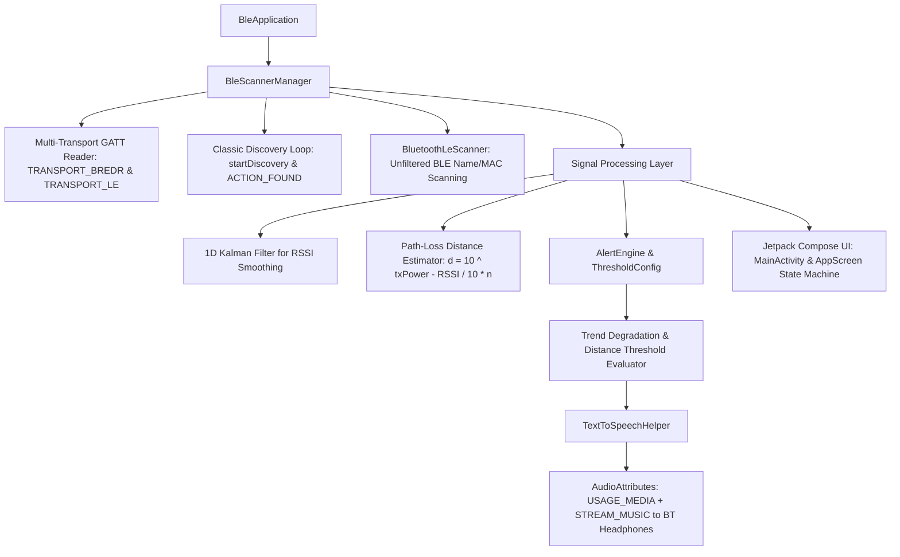

# BLE Proximity Alert

A proactive Android application built with Kotlin and Jetpack Compose that monitors a connected Bluetooth headphone or earphone (e.g., Sony WF-C500, AirPods, Galaxy Buds, neckbands) and delivers an **in-ear voice warning (Text-to-Speech)** directly through the connected earphones **before** the user walks out of range and the connection drops.

---

## 📌 Project Overview & Vision

When you leave your phone behind on a desk, table, or in a room and walk away while wearing Bluetooth earphones:
* Standard phones only alert *after* the Bluetooth connection drops, which causes the warning sound to play on the phone speaker across the room where you can no longer hear it.
* **BLE Proximity Alert** continuously monitors live link signal strength (RSSI), smooths noisy readings, calculates estimated distance in meters, detects negative signal degradation trends as you walk away, and speaks a voice warning **directly inside your Bluetooth earphones** while still connected.

---

## ✨ Key Features

- **In-Ear Voice Warnings**: TTS voice alerts route to `STREAM_MUSIC` / `USAGE_MEDIA` with `AUDIOFOCUS_GAIN_TRANSIENT_MAY_DUCK` so warnings play inside your connected earphones.
- **Live Distance & RSSI Tracking**: Real-time signal polling continuously calculates estimated distance in meters (e.g., `0.7m`, `1.5m`, `2.1m`, `3.5m`) while connected.
- **Multi-Transport Signal Engine**:
  1. **Dual-Transport GATT Polling**: Issues `readRemoteRssi()` every 1000ms over active `TRANSPORT_BREDR` and `TRANSPORT_LE` GATT links.
  2. **Classic Discovery Pings**: Triggers periodic `startDiscovery()` every 3000ms to capture `BluetoothDevice.ACTION_FOUND` broadcast intents with `EXTRA_RSSI`.
  3. **Unfiltered BLE Scanning**: Runs `BluetoothLeScanner` matching both device MAC address and device Name (e.g., `"WF-C500"`).
- **1D Kalman Filter**: Eliminates measurement noise on raw RSSI samples using process noise ($Q = 0.08$) and measurement noise ($R = 4.0$).
- **Log-Distance Path Loss Model**: Maps filtered RSSI ($\text{dBm}$) to distance ($d$) in meters:
  $$d = 10^{\frac{\text{txPower} - \text{RSSI}}{10 \cdot n}}$$
- **Smart Moving-Away Trend Detection**: Detects rapid RSSI degradation ($\Delta\text{RSSI} \ge 4\text{ dBm}$ drop over a 3-second window) to trigger early warnings.
- **User-Configurable Thresholds**: Supported distance options: `9.0m`, `8.0m`, `7.0m`, `6.0m`, `5.0m`, `4.0m`, `3.0m`, `2.0m`, `1.0m`, `0.5m`, `0.1m`.
- **Post-Disconnect Suppression**: Automatically suppresses alerts on phone speakers when a device unpairs or disconnects (`ACTION_ACL_DISCONNECTED`).
- **Foreground Service Background Execution**: Runs as `BleForegroundService` with `FOREGROUND_SERVICE_TYPE_CONNECTED_DEVICE` so signal tracking remains active when screen is off or app is minimized.
- **Jetpack Compose Material 3 UI**: Clean, modern UI with an explicit `AppScreen` state machine managing screen transitions.

---

## 📐 Architecture & Data Flow



---

## 🎯 Configurable Thresholds & Alert Levels

| Threshold | Alert Level | Behavior |
| :--- | :--- | :--- |
| **0.1m / 0.5m** | `CRITICAL` / `IMMINENT_DISCONNECT` | Critical threshold setting — triggers immediate warning if distance increases |
| **1.0m - 6.0m** | `WARNING` | Standard warning zone — triggers voice warning when user crosses set threshold or signal degrades |
| **7.0m - 8.0m** | `CRITICAL` | Imminent disconnection risk zone — escalates warning intensity |
| **9.0m+ / RSSI $\le -84$dBm** | `IMMINENT_DISCONNECT` | Link limit range — urgent warning spoken in-ear before connection is lost |

---

## 🛠️ Project Structure

```
ble-proximity-alert/
├── app/
│   ├── build.gradle.kts
│   └── src/main/
│       ├── AndroidManifest.xml
│       └── java/com/example/bleproximityalert/
│           ├── BleApplication.kt               # Application class & Notification channels
│           ├── MainActivity.kt                 # Activity entry point & AppScreen state machine
│           ├── MainViewModel.kt                # Main ViewModel managing scanner, TTS & UI state
│           ├── alert/
│           │   ├── AlertEngine.kt              # Signal degradation trend & alert evaluator
│           │   └── ThresholdConfig.kt          # User-configured distance thresholds & AlertLevels
│           ├── ble/
│           │   └── BleScannerManager.kt        # Multi-engine GATT, Classic Discovery & BLE Scanner
│           ├── model/
│           │   └── BleDevice.kt                # BleDevice data class (address, name, rssi, distance)
│           ├── service/
│           │   └── BleForegroundService.kt     # Foreground Service for background monitoring
│           ├── ui/
│           │   ├── DeviceSelectionScreen.kt    # Selection screen for paired/connected earphones
│           │   ├── StartMonitoringScreen.kt     # Pre-monitoring confirmation screen
│           │   ├── MonitoringScreen.kt         # Live RSSI & Distance meter screen
│           │   ├── SettingsScreen.kt           # Alert threshold selection screen
│           │   ├── AlertScreen.kt              # Proximity alert dialog/screen
│           │   └── PermissionRequestScreen.kt  # Runtime Bluetooth & Location permission screen
│           └── util/
│               ├── DistanceEstimator.kt        # Log-Distance Path Loss model
│               ├── KalmanFilter.kt             # 1D Kalman Filter implementation
│               ├── PermissionHelper.kt         # Android 12+ / 13+ permission checks
│               └── TextToSpeechHelper.kt       # In-ear TTS audio routing & AudioFocus helper
├── build.gradle.kts
├── gradle.properties                            # JDK 17 configuration (org.gradle.java.home)
├── GOAL.txt                                     # Project requirements specification
├── PROJECT_OVERVIEW_AND_MECHANISMS.md           # Detailed architecture & technical mechanisms document
└── README.md
```

---

## ⚙️ Tech Stack & Requirements

- **Language**: Kotlin 2.0.21
- **Build Tool**: Gradle 8.9 (configured with JDK 17 `jbr-17.0.14`)
- **UI Framework**: Jetpack Compose + Material 3 (with Compose Compiler Gradle Plugin `2.0.21`)
- **Architecture**: MVVM with `ViewModel` + `StateFlow`
- **Min SDK**: 24 (Android 7.0)
- **Target SDK**: 36 (Android 16)
- **Required Permissions**:
  - `BLUETOOTH_SCAN` & `BLUETOOTH_CONNECT` (Android 12+)
  - `ACCESS_FINE_LOCATION` & `ACCESS_COARSE_LOCATION`
  - `FOREGROUND_SERVICE` & `FOREGROUND_SERVICE_CONNECTED_DEVICE`
  - `POST_NOTIFICATIONS` (Android 13+)

---

## 🚀 Building & Running

### 1. Build Debug APK
```bash
./gradlew assembleDebug
```

### 2. Install on Connected Device
```bash
adb install -r app/build/outputs/apk/debug/app-debug.apk
```

### 3. Launch App
```bash
adb shell am start -n com.example.bleproximityalert/.MainActivity
```
